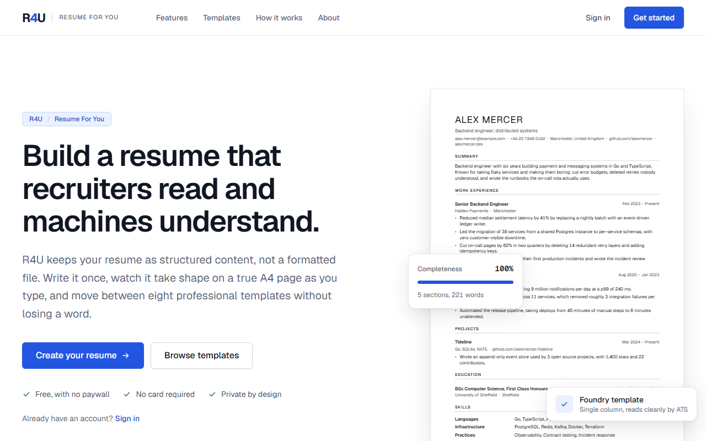
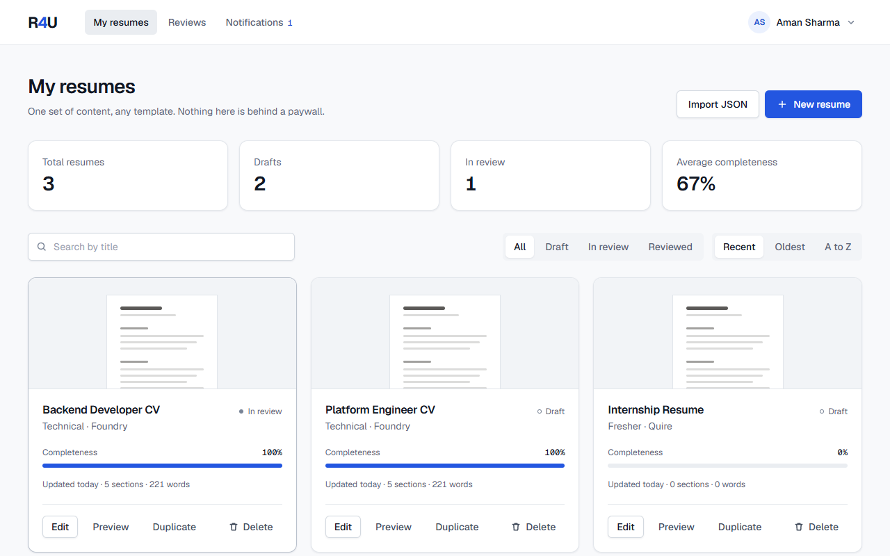
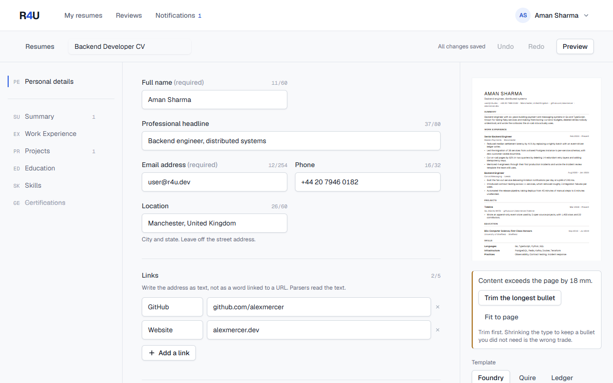
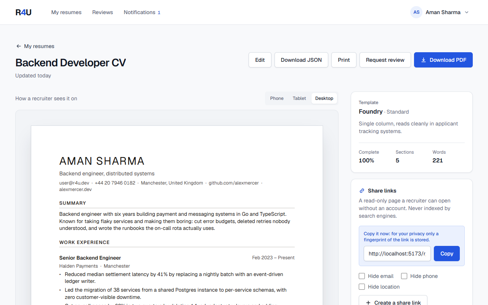
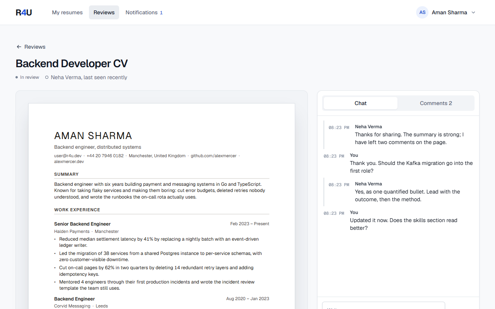
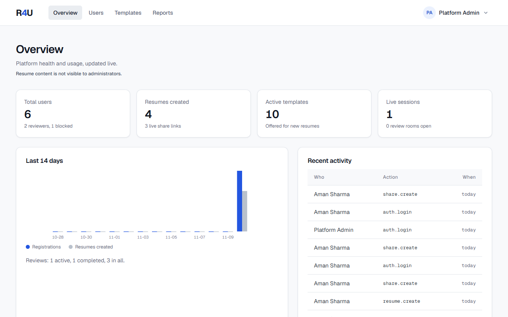
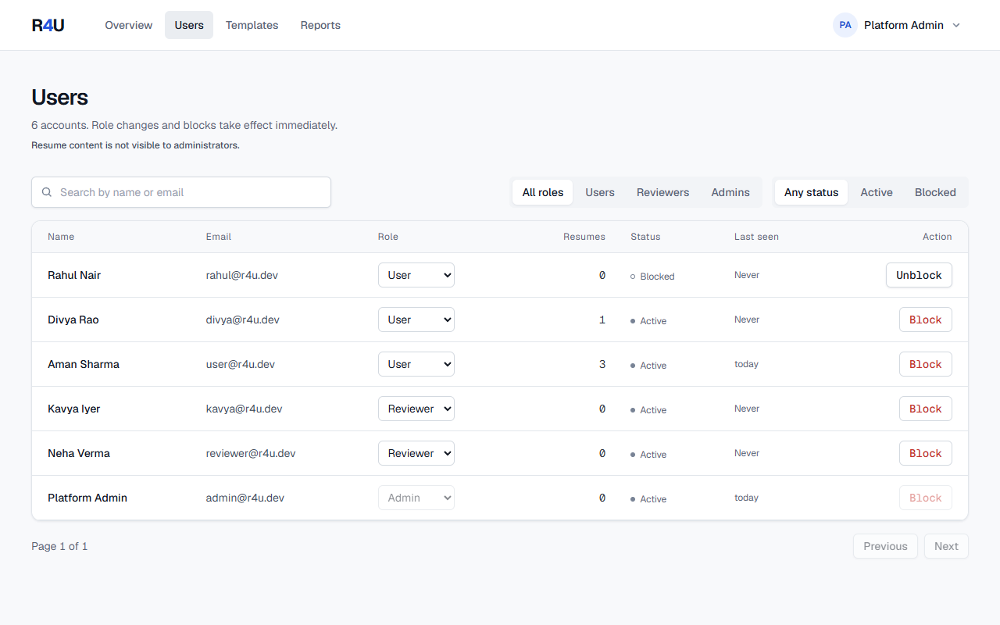
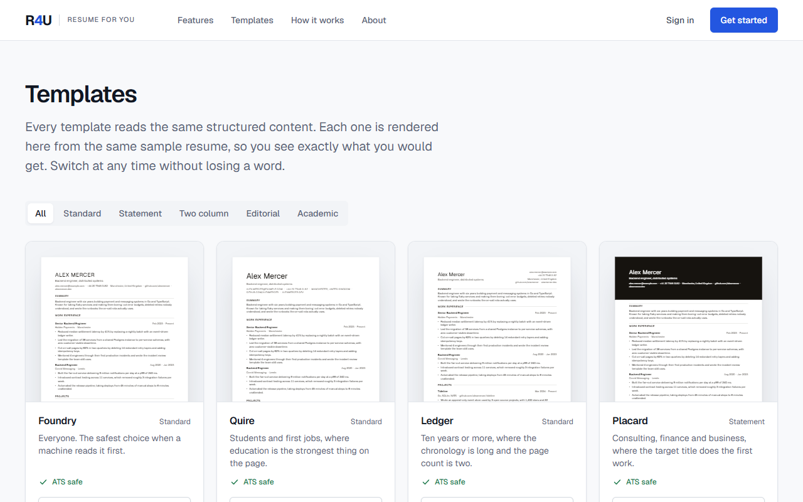
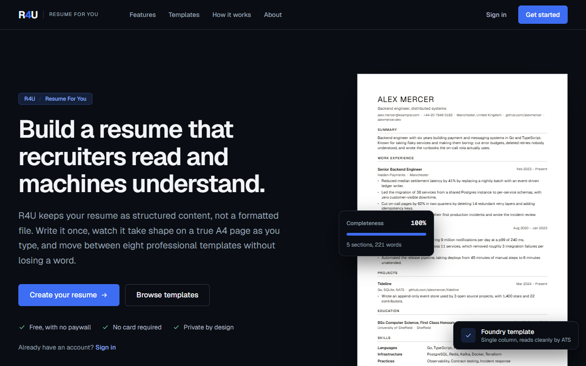
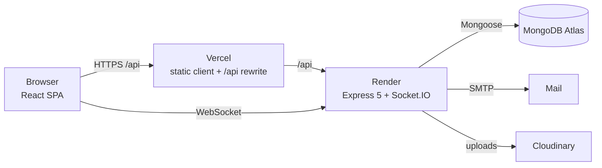

# R4U, Resume For You

An ATS-aware resume builder on the MERN stack, with a live A4 editor, real text-layer PDF export,
controlled share links, real-time mentor review and role-based administration.

Full Stack Development laboratory project. Adarsh Singh, D15A, roll 52.



The premise: a resume is **structured data, never a formatted file**. One dataset renders through any
of eight templates, exports to an A4 PDF whose text an applicant tracking system can read, and
publishes as a link the owner controls.

---

## Contents

- [Features](#features)
- [Screenshots](#screenshots)
- [Tech stack](#tech-stack)
- [Architecture](#architecture)
- [Getting started](#getting-started)
- [Demo accounts](#demo-accounts)
- [Environment variables](#environment-variables)
- [Scripts](#scripts)
- [Docker](#docker)
- [Deployment](#deployment)
- [API documentation](#api-documentation)
- [Testing](#testing)
- [Security](#security)
- [Checklist coverage](#checklist-coverage)
- [Known limitations](#known-limitations)
- [Documentation](#documentation)

---

## Features

**For everyone (no account)**

- Landing page built from live renders of the product, a public template gallery with category
  filters, and About, Privacy and Terms pages.
- A read-only resume page behind any share link (`/r/:slug`), with PDF download and a report
  button. Disabled, expired and unknown links show a clear message, never content.

**For a registered user**

- Register, sign in, sign out, reset a forgotten password by email, change the password, delete the
  account with everything it owns.
- Dashboard with search, status filter, sort, template tiles, statistics, duplicate and delete with
  confirmation. Start from scratch, from a complete sample, or by importing a JSON Resume file.
- Template selection with a career stage (fresher, professional, technical, academic) that seeds
  the right sections in the right order.
- Editor with structured fields, live validation, drag-and-drop reordering, hide without deleting,
  undo and redo, debounced autosave with conflict handling, a writing coach that flags weak bullets,
  a completeness score and a live A4 preview that warns, in millimetres, when content overflows.
- Eight templates plus presets, switchable without losing content; accent, type size, leading,
  spacing and margins.
- Version history with named snapshots and one-step restore.
- **PDF export** through `@react-pdf/renderer`: vector text, static embedded fonts, no ligatures,
  entries never split across pages. Print to PDF remains as a fallback.
- **Share links**: shown once, stored only as a hash, optional expiry, hide email, phone or
  location, turn on and off, view and download counts that update live, a 30-day chart.
- **Mentor review**: request a review from the reviewer directory; chat and section-pinned comments
  in real time; read receipts, typing indicator and presence.
- **Notifications**: live, coalesced for chat bursts, with an unread count in the navigation and a
  notification centre with filters.
- Light, dark and system themes, synced across devices.

**For a reviewer**

- Accept or decline requests, read the resume (never edit it, never see private notes), comment on
  sections, chat, and mark the review completed, which marks the resume reviewed for its owner.
- Edit a directory profile: bio, expertise, open slots, taking requests or not.

**For an administrator**

- Overview with totals, live sessions over Socket.IO and a 14-day chart.
- Users: search, filter, paginate, change role, block and unblock. A block signs the user out of
  every device immediately.
- Templates: edit metadata, reorder, activate and deactivate, and add presets over a code layout.
- Reported content, judged through the public page only, and an activity log kept for 180 days.
- **Cannot open private resume content.** Enforced in the database layer and covered by tests.

## Screenshots

|                                                              |                                                  |
| ------------------------------------------------------------ | ------------------------------------------------ |
|                  |            |
| Dashboard                                                    | Editor with live A4 preview and coaching         |
|  |  |
| Preview, PDF export and share links                          | Live review room                                 |
|        |  |
| Admin overview                                               | Manage users                                     |
|                  |  |
| Template gallery                                             | Dark theme                                       |

Phone layouts: [landing](docs/screenshots/landing-phone.png),
[public resume page](docs/screenshots/public-page-phone.png).

## Tech stack

| Layer    | Technology                                                                                                                                                                              |
| -------- | --------------------------------------------------------------------------------------------------------------------------------------------------------------------------------------- |
| Client   | React 19, Vite 8, TypeScript 5.9, Tailwind CSS v4, React Router 7, Context API with `useReducer`, Axios, Socket.IO client, `@react-pdf/renderer`, dnd-kit                               |
| Server   | Node.js 22, Express 5, Socket.IO 4, Mongoose 9, JWT with rotating refresh tokens, bcryptjs, express-validator, Zod, helmet, express-rate-limit, pino, nodemailer, multer and Cloudinary |
| Database | MongoDB (Atlas M0 in production, `mongodb-memory-server` in development and tests)                                                                                                      |
| Shared   | One TypeScript workspace with the resume schema, section registry, templates (a layout AST), linter and socket event schemas, used by both sides                                        |
| Testing  | Vitest, Testing Library, Supertest, socket.io-client, Playwright, Postman CLI                                                                                                           |
| Delivery | Docker and Docker Compose, nginx, GitHub Actions, Render (API) and Vercel (client)                                                                                                      |

Everything is free to build, run and host. See [docs/COST.md](docs/COST.md).

## Architecture



- **One layout AST, two adapters.** A template is a pure function from resume data to layout
  nodes. `renderToDom` draws them for the live preview and `renderToPdf` draws the same nodes for
  export, so the preview and the PDF cannot drift.
- **Fail-closed privacy.** A `pre(/^find/)` hook strips resume content from every query unless one
  of three named functions opts in, and none of them accepts an admin.
- **Real-time** uses one namespace and rooms (`user:`, `review:`, `presence:`, `admin:live`); every
  join is re-authorised against the database. See [docs/REALTIME.md](docs/REALTIME.md).

```
client/   React SPA: routes, components/ui, context (auth, theme, toast, socket), render adapters
server/   Express API and Socket.IO: modules/ (auth, users, resumes, share, reviews,
          notifications, templates, admin), models/, middleware/, sockets/, scripts/
shared/   schema, section registry, templates, linter, JSON Resume, platform types, socket schemas
tests/    Playwright end-to-end suite
docs/     design system, architecture, decisions, data model, API, realtime, routes, templates
```

More in [docs/ARCHITECTURE.md](docs/ARCHITECTURE.md) and [docs/DATA-MODEL.md](docs/DATA-MODEL.md).

## Getting started

Prerequisites: **Node.js 22** and **npm 10**. MongoDB is optional for local work.

```bash
git clone https://github.com/Anexus5919/r4u.git
cd r4u
npm install

# copy the example and set two different secrets of at least 32 characters each
cp .env.example server/.env

# terminal 1: the API on :5000 against an in-memory MongoDB, seeded with demo data
npm run dev:server:memory

# terminal 2: the client on :5173, proxying /api and /socket.io to :5000
npm run dev:client
```

Open http://localhost:5173. Without SMTP configured, the password reset email is written to the
server log in development, so the reset flow still works end to end.

To use a real database instead, set `MONGODB_URI` in `server/.env`, run `npm run dev:server`, and
seed it once with `npm run seed --workspace=server`.

## Demo accounts

Created by the seed (automatically on every in-memory boot). Password for all: `R4uDemo-2026!`

| Role           | Email              | What to try                                                               |
| -------------- | ------------------ | ------------------------------------------------------------------------- |
| User           | `user@r4u.dev`     | Three resumes, a live share link with history, an active review with chat |
| Reviewer       | `reviewer@r4u.dev` | The active review room; a completed review                                |
| Reviewer       | `kavya@r4u.dev`    | A pending request to accept or decline                                    |
| Admin          | `admin@r4u.dev`    | Overview, users, templates, reports                                       |
| User           | `divya@r4u.dev`    | A completed review                                                        |
| User (blocked) | `rahul@r4u.dev`    | Sign-in is refused                                                        |

On a production database the seed refuses the built-in password; set `SEED_PASSWORD` first.

## Environment variables

Server, in `server/.env` (validated with Zod at boot; the process refuses to start on a bad value):

| Variable                                                               | Required               | Purpose                                                                  |
| ---------------------------------------------------------------------- | ---------------------- | ------------------------------------------------------------------------ |
| `MONGODB_URI`                                                          | yes                    | Atlas connection string, or any MongoDB URI                              |
| `JWT_ACCESS_SECRET`, `JWT_REFRESH_SECRET`                              | yes                    | At least 32 characters each, and different                               |
| `JWT_ACCESS_TTL`, `JWT_REFRESH_TTL`                                    | no                     | Default `15m` and `30d`                                                  |
| `CORS_ORIGINS`                                                         | yes in production      | Comma-separated exact client origins                                     |
| `APP_URL`                                                              | yes in production      | Public client URL, used in share and reset links                         |
| `PORT`, `NODE_ENV`, `LOG_LEVEL`                                        | no                     | Defaults `5000`, `development`, `info`                                   |
| `SMTP_HOST`, `SMTP_PORT`, `SMTP_USER`, `SMTP_PASS`, `MAIL_FROM`        | no                     | Password reset email (a Gmail app password or Brevo free plan both work) |
| `CLOUDINARY_CLOUD_NAME`, `CLOUDINARY_API_KEY`, `CLOUDINARY_API_SECRET` | no                     | Avatar upload; reported as unavailable without them                      |
| `SEED_PASSWORD`                                                        | for seeding production | Password given to demo accounts                                          |

Client (build time, optional): `VITE_SOCKET_URL`, the API origin for the WebSocket when the client
and API are on different hosts. Empty means the same origin.

## Scripts

| Command                                     | What it does                                                                    |
| ------------------------------------------- | ------------------------------------------------------------------------------- |
| `npm run dev:server:memory`                 | API with an in-memory, seeded MongoDB                                           |
| `npm run dev:server` / `npm run dev:client` | API against `MONGODB_URI` / Vite client                                         |
| `npm run build`                             | Build shared, server and client                                                 |
| `npm run verify`                            | Design guard, lint, typecheck and all unit and integration tests                |
| `npm test`                                  | Vitest across the three workspaces                                              |
| `npm run test:e2e`                          | Playwright end-to-end suite (starts its own servers)                            |
| `npm run test:api`                          | Postman collection against a running API (`test:api:limits` for the 429 checks) |
| `npm run seed --workspace=server`           | Seed demo data into `MONGODB_URI`                                               |
| `npm run migrate --workspace=server`        | Create any missing index                                                        |

## Docker

```bash
docker compose up --build
docker compose exec server node server/dist/scripts/seed-cli.js   # optional demo data
```

Open http://localhost:8080. Compose runs MongoDB 7, the API (Node 22 alpine, non-root, health
checked) and the client (nginx serving the build and proxying `/api` and `/socket.io`, WebSocket
included). The defaults in `docker-compose.yml` are for a local machine only; put real secrets in a
`.env` file beside it.

## Deployment

The pipeline is ready; the accounts are yours to connect. All three services have free tiers.

1. **MongoDB Atlas**: create an M0 cluster, a database user and a network rule, and copy the
   connection string.
2. **Render (API)**: New, Blueprint, select this repository. `render.yaml` defines a Docker web
   service `r4u-api` with generated JWT secrets and a health check. Set `MONGODB_URI`,
   `CORS_ORIGINS` and `APP_URL` (your Vercel URL), and optionally SMTP and Cloudinary. Seed it once
   from the Render shell with `node server/dist/scripts/seed-cli.js` after setting `SEED_PASSWORD`.
3. **Vercel (client)**: import the repository with the root directory `client`. `client/vercel.json`
   installs from the workspace root, rewrites `/api/*` to the Render service so the refresh cookie
   stays same-site, and serves the SPA. Set `VITE_SOCKET_URL=https://r4u-api.onrender.com`. If your
   Render URL differs, update the rewrite destination.
4. **GitHub Actions**: add repository secrets `RENDER_DEPLOY_HOOK_URL`, and `VERCEL_TOKEN`,
   `VERCEL_ORG_ID`, `VERCEL_PROJECT_ID`. Every push to `main` then runs verify, tests, end-to-end,
   the Docker smoke test and the security scan, and deploys only if all of them pass.

Live URLs: not yet published. Add them here once the services above are connected.

## API documentation

- Every endpoint, guard, status code and error code: [docs/API.md](docs/API.md).
- Socket.IO events and payloads: [docs/REALTIME.md](docs/REALTIME.md).
- Postman: import [docs/r4u.postman_collection.json](docs/r4u.postman_collection.json) and
  [docs/r4u.postman_environment.json](docs/r4u.postman_environment.json), or run
  `npm run test:api`. Logins store tokens in the environment automatically.

Responses use one envelope: `{ "data": ..., "meta": ... }` on success and
`{ "error": { "code", "message", "details" } }` on failure. A resource you do not own answers 404,
never 403, so ids cannot be enumerated.

## Testing

| Suite          | Count       | Covers                                                                                                                                                        |
| -------------- | ----------- | ------------------------------------------------------------------------------------------------------------------------------------------------------------- |
| Vitest, shared | 211         | Schema, section registry, linter, quantification guard, JSON Resume, templates                                                                                |
| Vitest, server | 129         | Auth, roles, the admin content ban, resumes, autosave conflicts, versions, sharing, reviews, notifications, admin, seed, and Socket.IO against a real server  |
| Vitest, client | 66          | Reducer, autosave diff, guards, session restore, preview, DOM adapter, PDF for all eight templates                                                            |
| Playwright     | 12          | Registration, wrong password, guards, live share counter, PDF download, unknown link, live chat, admin privacy line, three viewport widths, mobile navigation |
| Postman        | 58 requests | Happy paths plus 401, 403, 404, 409, 410, 422 and 429                                                                                                         |

## Security

- Passwords hashed with bcrypt and never selected or serialised. Access tokens live in memory;
  refresh tokens are httpOnly cookies that rotate on every use, with family revocation on replay.
- Every request re-checks a token version, so a block or a password reset ends every session at once.
- Roles are checked by set membership, never a rank ladder, so an admin is not a superset of a user.
- Inputs validated with express-validator (HTTP) and Zod (sockets); controllers read only validated
  data. Mongoose `sanitizeFilter` is on.
- helmet, an exact CORS allowlist, tiered rate limits, persistent login lockout, and `trust proxy`
  set to `1`.
- Share links are stored only as a SHA-256, never indexed, never leaked through a referrer, and
  honour redaction. Hidden sections and private notes never leave the server.
- Structured logging with pino and redaction of credentials; a buffered activity log with an
  allowlisted metadata field.

## Checklist coverage

| Checklist area                                            | Where it lives                                                                                                                                  |
| --------------------------------------------------------- | ----------------------------------------------------------------------------------------------------------------------------------------------- |
| Responsive UI, Tailwind, dark mode                        | `client/src/styles/tokens.css`, `components/ui`, Playwright viewport tests                                                                      |
| Forms, loading, errors, toasts, modals, search and filter | Auth pages, editor, dashboard, `ToastProvider`, `Modal`                                                                                         |
| Hooks, Context, custom hooks                              | `context/` (Auth, Theme, Toast, Socket), `hooks/` (`useDebounce`, `useResumes`, `useDismiss`, `useResumeImport`, `useTemplates`, `useAutosave`) |
| State management                                          | Context API with `useReducer` (ADR-010)                                                                                                         |
| REST API with CRUD and status codes                       | `server/src/modules/*`, [docs/API.md](docs/API.md)                                                                                              |
| MongoDB and Mongoose                                      | 15 models, references and `populate`, indexes and TTLs ensured at boot                                                                          |
| Secure API                                                | Validation, central error handler, `.env` with Zod, bcrypt, pino                                                                                |
| JWT auth and roles                                        | Register, login, refresh, logout, guards, user, reviewer and admin roles                                                                        |
| Real-time                                                 | Socket.IO review rooms, chat, comments, presence, typing, notifications, admin live counter                                                     |
| Docker                                                    | `server/Dockerfile`, `client/Dockerfile`, `.dockerignore`, `docker-compose.yml`                                                                 |
| CI/CD and deployment                                      | `.github/workflows/ci.yml`, `render.yaml`, `client/vercel.json`                                                                                 |
| Testing                                                   | Vitest, Playwright, Postman collection                                                                                                          |

## Known limitations

- Render's free tier sleeps after 15 minutes idle, so the first request afterwards waits 30 to 60
  seconds. The client says so in one line instead of failing. No keep-alive cron is used, because a
  permanently warm service would consume 720 of the 750 monthly instance hours.
- Rate limits use an in-memory store that resets on restart; persistent login lockout on the user
  document is what survives a restart.
- Not yet built from the longer roadmap: the published ATS readiness score (phase 10), DOCX
  export, guest drafts, and the hero lockup animation in `docs/LANDING.md`.

## Documentation

| Question                          | File                                                                             |
| --------------------------------- | -------------------------------------------------------------------------------- |
| Why was this chosen?              | [docs/DECISIONS.md](docs/DECISIONS.md)                                           |
| How is it wired?                  | [docs/ARCHITECTURE.md](docs/ARCHITECTURE.md)                                     |
| What does a collection look like? | [docs/DATA-MODEL.md](docs/DATA-MODEL.md)                                         |
| Which route, which guard?         | [docs/ROUTES.md](docs/ROUTES.md)                                                 |
| Which socket event?               | [docs/REALTIME.md](docs/REALTIME.md)                                             |
| How does a template lay out?      | [docs/TEMPLATES.md](docs/TEMPLATES.md)                                           |
| Colours, type, spacing            | [docs/DESIGN-SYSTEM.md](docs/DESIGN-SYSTEM.md)                                   |
| Requirements and status           | [docs/REQUIREMENTS.md](docs/REQUIREMENTS.md), [docs/ROADMAP.md](docs/ROADMAP.md) |
| Cost of every service             | [docs/COST.md](docs/COST.md)                                                     |

## Credits

Typefaces: Geist and Geist Mono (interface), Source Serif 4 and Source Sans 3 (resume documents),
all under the SIL Open Font License 1.1.
